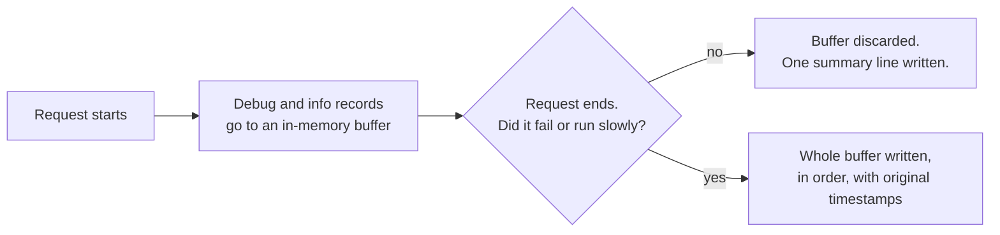
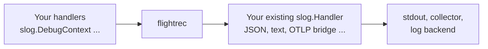

# flightrec

**Debug logs for the requests that fail. One line for the ones that don't.**

[](https://github.com/divine-ai-com/flightrec/actions/workflows/ci.yml)
[](https://pkg.go.dev/github.com/divine-ai-com/flightrec)
[](https://github.com/divine-ai-com/flightrec/releases)
[](LICENSE)

flightrec is a handler for Go's `log/slog` that works like an aircraft flight recorder. It records every request's debug and info logs in memory and writes them out only when that request fails or runs slowly. A healthy request leaves one summary line.

```jsonc
// POST /checkout -> 200. Three records were buffered, then discarded.
{"level":"INFO","msg":"request completed","flightrec.trace_id":"req-1041","duration":37660,"flightrec.dropped_records":3,"status":200,"method":"POST","path":"/checkout"}

// POST /checkout -> 502. The error is written at once, followed by everything that led up to it.
{"level":"ERROR","msg":"payment provider timed out","flightrec.trace_id":"req-1042","attempt":3}
{"level":"DEBUG","msg":"loaded cart","flightrec.trace_id":"req-1042","flightrec.flush_reason":"error_log","items":3}
{"level":"DEBUG","msg":"reserved inventory","flightrec.trace_id":"req-1042","flightrec.flush_reason":"error_log","warehouse":"eu-central-1"}
{"level":"INFO","msg":"calling payment provider","flightrec.trace_id":"req-1042","flightrec.flush_reason":"error_log","provider":"stripe"}
```

Real output from the same handler code, with the `time` field removed. Every record keeps its original timestamp.

## The problem

Services log everything in case it is needed later, and almost none of it is ever read. You pay to serialize, ship, store and index it anyway.

The usual fix is to turn debug logging off in production. That works until a request fails, and then the detail you need to explain the failure was never written. So teams choose between two bad options:

| | Debug logging on | Debug logging off |
| --- | --- | --- |
| Log volume and cost | High, mostly noise from healthy requests | Low |
| When a request fails | Full detail | An error line and guesswork |

flightrec removes the choice. Healthy requests cost one line. Failed requests come with their full history.

## How it works



1. Middleware opens a scope for each request, keyed by its trace ID.
2. Records below the pass level (Warn by default) are buffered in that scope. Warnings and errors are written immediately, as before.
3. When the request ends, the scope is kept if it logged an error, returned a 5xx, panicked, ran longer than `SlowAfter`, or called `flightrec.Flush`.
4. Otherwise the buffer is discarded and one summary line records the duration, status and how many records were dropped.

Memory is bounded per request and for the whole process. The design is described in [docs/design.md](docs/design.md).

## Where it fits



flightrec sits between your code and the `slog.Handler` you already use. It decides what reaches that handler and changes nothing after it: the same format, the same shipping, the same backend.

Use it when:

- Your service handles requests (HTTP, gRPC, queue jobs) and logs with `slog`.
- You run with debug logging off to control cost, and miss the detail during incidents.
- You run with debug logging on, and most of your log bill is healthy traffic.

It is not the right tool when:

- You need every log line retained, for example for audit. Log those at or above the pass level, or outside flightrec, and they are never buffered.
- Your logging does not pass a `context.Context`. Only `slog.DebugContext(ctx, ...)` style calls can be tied to a request.

## Features

- **Drop-in.** Wraps any `slog.Handler`. Adoption is three lines; existing log calls stay as they are.
- **Five triggers.** Error log, 5xx or gRPC error, panic, slow request, or an explicit `Flush` from your own code.
- **Bounded memory.** A cap per request and a cap for the process, with a counter for every drop.
- **Trace IDs on every line.** Read from `traceparent`, `X-Trace-Id` or `X-Request-Id`, or generated.
- **No dependencies.** The module uses only the standard library.

## Install

```bash
go get github.com/divine-ai-com/flightrec
```

Requires Go 1.24 or later.

## Quick start

```go
package main

import (
	"log/slog"
	"net/http"
	"os"
	"time"

	"github.com/divine-ai-com/flightrec"
)

func main() {
	rec := flightrec.New(flightrec.Options{
		Next:        slog.NewJSONHandler(os.Stdout, nil), // your existing handler
		PassLevel:   slog.LevelWarn,                      // written immediately
		BufferLevel: slog.LevelDebug,                     // buffered per request
		SlowAfter:   2 * time.Second,                     // slow requests are kept too
	})
	slog.SetDefault(slog.New(rec))

	mux := http.NewServeMux()
	mux.HandleFunc("/checkout", func(w http.ResponseWriter, r *http.Request) {
		slog.DebugContext(r.Context(), "loaded cart", "items", 3)
		w.WriteHeader(http.StatusOK)
	})

	http.ListenAndServe(":8080", flightrec.HTTPMiddleware(rec)(mux))
}
```

The three changes are: create the recorder around your handler, set it as the default logger, wrap your router.

## Usage

### Keep a request that did not fail

Call `Flush` anywhere in the request. The reason appears on every flushed record.

```go
if order.Total != charged {
	flightrec.Flush(ctx, "payment mismatch")
}
```

### Background jobs and queue consumers

Logs outside a request go straight to your handler. To buffer a unit of work, open a scope around it.

```go
func processJob(ctx context.Context, rec *flightrec.Recorder, jobID string) (err error) {
	ctx, scope := flightrec.StartScope(ctx, rec, flightrec.ScopeMeta{
		TraceID: jobID,
		Method:  "JOB",
		Path:    "sync-invoices",
	})
	defer func() {
		status := 200
		if err != nil {
			status = 500 // 500 or above keeps the buffer
		}
		scope.End(ctx, status)
	}()

	slog.DebugContext(ctx, "fetched invoice batch", "size", 250)
	return syncInvoices(ctx)
}
```

### gRPC

`InvokeGRPCUnary` adapts to a unary server interceptor without adding gRPC as a dependency of this module.

```go
grpc.UnaryInterceptor(func(ctx context.Context, req any, info *grpc.UnaryServerInfo, handler grpc.UnaryHandler) (any, error) {
	return flightrec.InvokeGRPCUnary(ctx, rec, info.FullMethod, nil, req, handler)
})
```

### Choose what is buffered

| Option | Default | Effect |
| --- | --- | --- |
| `PassLevel` | `slog.LevelWarn` | Records at or above this level are written immediately |
| `BufferLevel` | `slog.LevelDebug` | Records at or above this level, and below `PassLevel`, are buffered |
| `SlowAfter` | off | Requests that take this long or longer are kept |
| `DisableHealthySummary` | `false` | Turns off the summary line for healthy requests |

Set both levels explicitly, as in the quick start.

### Limit memory

| Option | Default | When the limit is reached |
| --- | --- | --- |
| `MaxPerScope` | 256 KB | The request drops its oldest records, and its flushed output is marked `flightrec.truncated` |
| `MaxTotal` | 64 MB | The oldest requests lose their buffers |

### Monitor it

`Recorder.Stats()` returns a snapshot you can export to your metrics system.

```go
st := rec.Stats()
slog.Info("flightrec",
	"active_scopes", st.ActiveScopes,
	"buffered_bytes", st.BufferedBytes,
	"scopes_flushed", st.ScopesFlushed,
	"dropped_per_scope_cap", st.RecordsDroppedPerScopeCap,
	"dropped_total_cap", st.RecordsDroppedTotalCap,
)
```

## What appears in your logs

| Attribute | On | Meaning |
| --- | --- | --- |
| `flightrec.trace_id` | every record in a request | The request's trace ID |
| `flightrec.flush_reason` | flushed records | Why the request was kept (see below) |
| `flightrec.truncated`, `flightrec.dropped_records` | first flushed record, if records were lost | The buffer hit a memory limit |
| `duration`, `status`, `method`, `path`, `flightrec.dropped_records` | the summary line | Outcome of a healthy request |

| Trigger | `flightrec.flush_reason` |
| --- | --- |
| A record at Error level or above was logged | `error_log` |
| Response status 500 or above | `http_500`, `http_502`, `http_503`, `http_504`, `http_5xx` |
| The gRPC handler returned an error | `grpc_error` |
| The handler panicked (the panic is re-raised after the flush) | `panic` |
| The request took `SlowAfter` or longer | `slow_request` |
| The code called `flightrec.Flush(ctx, reason)` | the reason given |

## Performance

Measured on v0.1.0 with Go 1.27.4, linux/amd64, Intel Xeon 2.20 GHz, 4 vCPU, median of 5 runs. Reproduce with:

```bash
go test -bench=. -benchmem -run='^$' . && go run ./cmd/demo
```

Cost of one request that makes 20 log calls with 3 attributes each:

| Path | Time per log call | Allocations per request |
| --- | ---: | ---: |
| Plain slog, debug logging off | 16 ns | 0 |
| **flightrec, healthy request (buffered, then discarded)** | **790 ns** | **4** |
| Plain slog, debug logging on (JSON to `io.Discard`) | 1,260 ns | 0 |
| flightrec, records at Warn or above (written immediately) | 1,650 ns | 4 |
| flightrec, failed request (buffered, then written) | 2,170 ns | 4 |

How to read this:

- Against always-on debug logging, a healthy request costs about 37% less CPU and writes one line.
- Against debug logging turned off, buffering is not free. Each buffered call costs about 790 ns, most of it the timestamp and caller lookup that `slog` performs for any enabled record. That is the price of having the detail when a request fails.
- Calls with more than 5 attributes allocate once per call, as they do in `slog` itself (24 allocations per request against 20 for plain slog, measured with a child logger and 6 attributes).

Log volume in the bundled demo, 1,000 requests with 1% failing and 20 debug records each:

| | Lines | Bytes |
| --- | ---: | ---: |
| Plain slog at Debug | 20,010 | 3.69 MB |
| flightrec | 1,200 | 275 KB |

The demo is synthetic: every record is at Debug level, so the 92.5% reduction follows from the 1% failure rate. All 10 failed requests keep their 20 records in order.

## How it compares

| Tool | What it does well | How flightrec differs |
| --- | --- | --- |
| [slogbox](https://github.com/alexrios/slogbox), [slog-fingerscrossed](https://github.com/hectorj/slog-fingerscrossed) | Small, focused buffering handlers for `slog` | Per-request scopes with trace IDs, two memory caps with drop counters, and triggers for status, panics and slow requests |
| AWS Lambda Powertools | Per-invocation log buffering with flush on error | Runs in any Go HTTP or gRPC server, not only on Lambda |
| OpenTelemetry Collector tail sampling | Trace-aware decisions across services | Drops healthy detail inside the process, before it is serialized or sent |
| `runtime/trace.FlightRecorder` | Low-overhead recording of Go runtime events | Records application logs, not scheduler and GC events |

## Limits

- **Logs only.** Traces are planned for v0.2.
- **One service.** A failure does not yet flush the buffers of upstream or downstream services. Planned for v0.3.
- **A hard kill loses the buffer.** Panics are flushed. `SIGKILL` and out-of-memory kills are not, until v0.4.
- **The context must be passed.** `slog.Debug(...)` without a context has no request to attach to and is handled as a log outside a request.
- **Values are captured by reference.** A pointer logged with `slog.Any` shows its state at flush time.

Known defects in v0.1.0 are tracked in the [v0.1.1 milestone](https://github.com/divine-ai-com/flightrec/milestone/1).

## Stability

flightrec follows semantic versioning. Before 1.0, a minor release may change the API; such changes are listed first in the [changelog](CHANGELOG.md).

## Documentation

- [Quickstart](docs/quickstart.md)
- [Design](docs/design.md)
- [Troubleshooting](docs/troubleshooting.md)
- [API reference](https://pkg.go.dev/github.com/divine-ai-com/flightrec)

## Contributing

See [CONTRIBUTING.md](CONTRIBUTING.md). To report a vulnerability, follow the [security policy](SECURITY.md).

## License

Apache-2.0. See [LICENSE](LICENSE).
