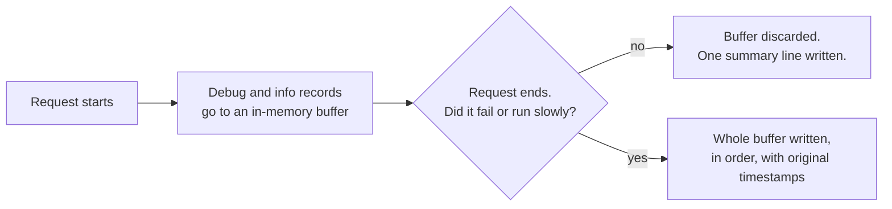
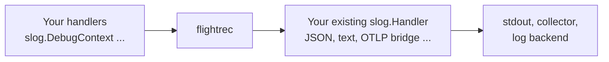

# flightrec

**Debug logs for the requests that fail. One line for the ones that don't.**

[](https://github.com/divine-ai-com/flightrec/actions/workflows/ci.yml)
[](https://pkg.go.dev/github.com/divine-ai-com/flightrec)
[](https://github.com/divine-ai-com/flightrec/releases)
[](LICENSE)

flightrec is a handler for Go's `log/slog` that works like an aircraft flight recorder. It records every request's debug and info logs in memory and writes them out only when that request fails or runs slowly. A healthy request leaves one summary line.

```jsonc
// POST /checkout -> 200. Three records were buffered, then discarded.
{"level":"INFO","msg":"request completed","flightrec.trace_id":"req-1041","duration":37660,"flightrec.dropped_records":3,"status":200,"method":"POST","path":"/checkout"}

// POST /checkout -> 502. The error is written at once, followed by everything that led up to it.
{"level":"ERROR","msg":"payment provider timed out","flightrec.trace_id":"req-1042","attempt":3}
{"level":"DEBUG","msg":"loaded cart","flightrec.trace_id":"req-1042","flightrec.flush_reason":"error_log","items":3}
{"level":"DEBUG","msg":"reserved inventory","flightrec.trace_id":"req-1042","flightrec.flush_reason":"error_log","warehouse":"eu-central-1"}
{"level":"INFO","msg":"calling payment provider","flightrec.trace_id":"req-1042","flightrec.flush_reason":"error_log","provider":"stripe"}
```

Real output from the same handler code, with the `time` field removed. Every record keeps its original timestamp.

## The problem

Services log everything in case it is needed later, and almost none of it is ever read. You pay to serialize, ship, store and index it anyway.

The usual fix is to turn debug logging off in production. That works until a request fails, and then the detail you need to explain the failure was never written. So teams choose between two bad options:

| | Debug logging on | Debug logging off |
| --- | --- | --- |
| Log volume and cost | High, mostly noise from healthy requests | Low |
| When a request fails | Full detail | An error line and guesswork |

flightrec removes the choice. Healthy requests cost one line. Failed requests come with their full history.

## How it works



1. Middleware opens a scope for each request, keyed by its trace ID.
2. Records below the pass level (Warn by default) are buffered in that scope. Warnings and errors are written immediately, as before.
3. When the request ends, the scope is kept if it logged an error, returned a 5xx, panicked, ran longer than `SlowAfter`, or called `flightrec.Flush`.
4. Otherwise the buffer is discarded and one summary line records the duration, status and how many records were dropped.

Memory is bounded per request and for the whole process. The design is described in [docs/design.md](docs/design.md).

## Where it fits



flightrec sits between your code and the `slog.Handler` you already use. It decides what reaches that handler and changes nothing after it: the same format, the same shipping, the same backend.

Use it when:

- Your service handles requests (HTTP, gRPC, queue jobs) and logs with `slog`.
- You run with debug logging off to control cost, and miss the detail during incidents.
- You run with debug logging on, and most of your log bill is healthy traffic.

It is not the right tool when:

- You need every log line retained, for example for audit. Log those at or above the pass level, or outside flightrec, and they are never buffered.
- Your logging does not pass a `context.Context`. Only `slog.DebugContext(ctx, ...)` style calls can be tied to a request.

## Features

- **Drop-in.** Wraps any `slog.Handler`. Adoption is three lines; existing log calls stay as they are.
- **Five triggers.** Error log, 5xx or gRPC error, panic, slow request, or an explicit `Flush` from your own code.
- **Survives a hard kill.** With `StartJournal`, the debug logs of requests in flight when the process was killed are recovered on the next start.
- **Bounded memory.** A cap per request and a cap for the process, with a counter for every drop.
- **Trace IDs on every line.** Read from `traceparent`, `X-Trace-Id` or `X-Request-Id` (validated), an active OpenTelemetry span, or generated.
- **No dependencies.** The module uses only the standard library.

## Install

```bash
go get github.com/divine-ai-com/flightrec
```

Requires Go 1.26 or later.

## Quick start

```go
package main

import (
	"log/slog"
	"net/http"
	"os"
	"time"

	"github.com/divine-ai-com/flightrec"
)

func main() {
	rec := flightrec.New(flightrec.Options{
		Next:          slog.NewJSONHandler(os.Stdout, nil), // your existing handler
		PassLeveler:   slog.LevelWarn,                      // written immediately
		BufferLeveler: slog.LevelDebug,                     // buffered per request
		SlowAfter:     2 * time.Second,                     // slow requests are kept too
	})
	slog.SetDefault(slog.New(rec))

	mux := http.NewServeMux()
	mux.HandleFunc("/checkout", func(w http.ResponseWriter, r *http.Request) {
		slog.DebugContext(r.Context(), "loaded cart", "items", 3)
		w.WriteHeader(http.StatusOK)
	})

	http.ListenAndServe(":8080", flightrec.HTTPMiddleware(rec)(mux))
}
```

The three changes are: create the recorder around your handler, set it as the default logger, wrap your router.

## Usage

### Keep a request that did not fail

Call `Flush` anywhere in the request. The reason appears on every flushed record.

```go
if order.Total != charged {
	flightrec.Flush(ctx, "payment mismatch")
}
```

### Background jobs and queue consumers

Logs outside a request go straight to your handler. To buffer a unit of work, open a scope around it.

```go
func processJob(ctx context.Context, rec *flightrec.Recorder, jobID string) (err error) {
	ctx, scope := flightrec.StartScope(ctx, rec, flightrec.ScopeMeta{
		TraceID: jobID,
		Method:  "JOB",
		Path:    "sync-invoices",
	})
	defer func() {
		status := 200
		if err != nil {
			status = 500 // 500 or above keeps the buffer
		}
		scope.End(ctx, status)
	}()

	slog.DebugContext(ctx, "fetched invoice batch", "size", 250)
	return syncInvoices(ctx)
}
```

### gRPC

Use the `github.com/divine-ai-com/flightrec/grpcflightrec` module. Server interceptors open a scope per RPC, read the trace ID from incoming metadata (`traceparent`, `x-trace-id`, `x-request-id`), and set the `flightrec-flush` trailer when the RPC is kept. Client interceptors read that trailer, as `NewTransport` does for HTTP (see [Keep logs across services](#keep-logs-across-services)):

```go
import "github.com/divine-ai-com/flightrec/grpcflightrec"

srv := grpc.NewServer(
	grpc.UnaryInterceptor(grpcflightrec.UnaryServerInterceptor(rec)),
	grpc.StreamInterceptor(grpcflightrec.StreamServerInterceptor(rec)),
)

conn, err := grpc.NewClient(target,
	grpc.WithUnaryInterceptor(grpcflightrec.UnaryClientInterceptor()),
	grpc.WithStreamInterceptor(grpcflightrec.StreamClientInterceptor()),
	// credentials and other options
)
```

Or use `flightrec.InvokeGRPCUnary` and `flightrec.InvokeGRPCStream` directly from the zero-dependency root module.

### OpenTelemetry traces and logs

Use the `github.com/divine-ai-com/flightrec/otelflightrec` submodule to buffer finished child spans per trace and export them only when the trace or its linked `flightrec.Scope` triggers:

```go
import "github.com/divine-ai-com/flightrec/otelflightrec"

sp := otelflightrec.NewSpanProcessor(otelflightrec.SpanProcessorOptions{
	Next:          sdktrace.NewBatchSpanProcessor(spanExporter),
	Recorder:      rec,                                  // shares triggers between logs and traces
	HealthyPolicy: otelflightrec.HealthyExportRootOnly, // or HealthyExportNone
	SlowAfter:     2 * time.Second,
})
tp := sdktrace.NewTracerProvider(sdktrace.WithSpanProcessor(sp))
```

To bridge `slog` records directly to OpenTelemetry Logs (`go.opentelemetry.io/otel/log`) with log-time `TraceID` and child `SpanID` correlation:

```go
rec := flightrec.New(flightrec.Options{
	Next: otelflightrec.NewLogHandler(otelflightrec.LogHandlerOptions{
		LoggerProvider: logProvider,
		Next:           slog.NewJSONHandler(os.Stdout, nil), // optional stdout mirror
	}),
})
```

### Keep logs across services

A failure in one service usually starts in a request that passed through several. flightrec can keep the logs of every service that handled the request, not only the one that failed. Each service needs the same trace ID for the request: OpenTelemetry propagation, or `X-Request-Id` set on outgoing calls, provides it.

**When the caller sees the failure.** A service whose request is kept marks its response with a `Flightrec-Flush` header (gRPC: a trailer). Wrap outgoing clients so the caller keeps its own logs for that request; its response is marked in turn, so the flush travels up the chain:

```go
client := &http.Client{Transport: flightrec.NewTransport(http.DefaultTransport)}
```

**When the caller has already finished.** A service that answered before the failure happened (an asynchronous call, a queue consumer, a parallel call to another service) keeps its buffers for a while with `Retain`, and a notifier tells it about the failure:

```go
rec := flightrec.New(flightrec.Options{
	Next:   handler,
	Retain: 30 * time.Second, // keep healthy requests' logs this long
})

n, err := redisnotifier.New(redisClient, redisnotifier.WithChannel("flightrec:prod"))
if err != nil {
	return err
}
stop := rec.StartNotifier(ctx, n)
defer stop()
```

Notifiers ship as separate modules: [`notifier/redisnotifier`](notifier/redisnotifier) (Redis pub/sub) and [`notifier/natsnotifier`](notifier/natsnotifier) (NATS). [`notifier/memnotifier`](notifier/memnotifier) connects Recorders in one process.

Logs kept this way carry the reason `downstream:<reason>` or `remote:<reason>`, so you can see why a service that succeeded wrote its logs. Both mechanisms are best effort: a response header a proxy strips, a notice published while a service is disconnected, or a retained buffer that has expired means those logs are missing.

On a service that answers clients outside your system, set `DisableFlushMarker: true` and `IgnoreRequestTraceIDs: true`, so you neither tell outsiders about your failures nor let them choose the trace IDs your logs are grouped by.

[`examples/cross-service`](examples/cross-service) runs three services through both cases, in one process or with Docker Compose and Redis.

### Survive a hard kill

A request that is in flight when the process is killed (`SIGKILL`, an out-of-memory kill, a shutdown grace period that ran out) never reaches its flush, and its buffer dies with the process. Those are often the requests you most need to see. `StartJournal` writes every buffered record to a memory-mapped file that the kernel keeps when the process dies; the next start recovers the requests that did not finish:

```go
stop, err := rec.StartJournal("/var/run/flightrec/journal") // an emptyDir volume in Kubernetes
if err != nil {
	return err // or log it and run without a journal
}
defer stop() // after the server has drained
```

On restart, before it returns, `StartJournal` writes each interrupted request's buffered records with their original time, level and attributes, tagged `flightrec.flush_reason=crash_recovery` and `flightrec.recovered=true`, then one `request interrupted by crash` line with the method, path and start time:

```json
{"level":"DEBUG","msg":"calling payment provider","flightrec.trace_id":"492b372d...","flightrec.flush_reason":"crash_recovery","provider":"acme-pay","flightrec.recovered":true,"flightrec.recovered_host":"checkout-7d9f"}
{"level":"ERROR","msg":"request interrupted by crash","flightrec.trace_id":"492b372d...","flightrec.recovered_records":2,"method":"GET","path":"/checkout","start":"2026-11-15T18:20:36.966Z"}
```

What to know:

- **The file is a ring.** It holds the most recent records of all requests, healthy ones included, so size it (`WithJournalSize`, 16 MB by default) as journaled bytes per second times the longest request you want to recover. `Stats().JournalOldestAge` shows the time span it covers.
- **Cost.** Each buffered record is also encoded into the file: 10 to 25% more time per buffered record in our benchmarks, and no extra allocations. Recovery reads the old file one stripe at a time; it takes well under a second at the default size.
- **Safety.** The file is created with mode 0600 and locked; it holds debug data before any redaction your handler applies, so keep the directory private. `stop` and recovery overwrite it with zeros before removing it. Torn writes, a damaged file and a crash during recovery are handled: entries are checksummed, and a file that fails recovery three times is abandoned. A file at the path that is not a journal is never deleted.
- **Scope.** It survives the death of the process, not of the machine, and records are written at least once: a crash during a flush or during recovery can repeat some lines. Unix only; `StartJournal` returns `ErrJournalUnsupported` on Windows.

[`examples/crash-recovery`](examples/crash-recovery) kills a server with `kill -9` in the middle of a request and shows the recovered logs.

### Choose what is buffered

| Option | Default | Effect |
| --- | --- | --- |
| `PassLeveler` | `slog.LevelWarn` | Records at or above this level inside a scope are written immediately |
| `BufferLeveler` | `slog.LevelDebug` | Records at or above this level, and below `PassLeveler`, are buffered |
| `SlowAfter` | off | Requests that take this long or longer are kept |
| `DisableHealthySummary` | `false` | Turns off the summary line for healthy requests |

Set both levels explicitly, as in the quick start. Outside a scope, records are delegated to `Next.Enabled` and `Next.Handle` unchanged; inside a scope, flushed records bypass `Next`'s level so debug detail for failed requests is never lost (see [Level Filtering](https://pkg.go.dev/github.com/divine-ai-com/flightrec#hdr-Level_Filtering)).

### Limit memory

| Option | Default | When the limit is reached |
| --- | --- | --- |
| `MaxPerScope` | 256 KB | The request drops its oldest records, and its flushed output is marked `flightrec.truncated` |
| `MaxTotal` | 64 MB | The oldest requests lose their buffers |

### Trace IDs from requests

The trace ID is taken from `traceparent`, then `X-Trace-Id`, then `X-Request-Id`. `X-Trace-Id` and `X-Request-Id` values are used only when they are 1 to 128 bytes of letters, digits and `_ . : - / + = @`; otherwise the next source is tried, then an active OpenTelemetry span, and finally a generated ID.

A client can choose these headers. On services that receive requests from outside your system, such as a public API, set `IgnoreRequestTraceIDs: true` so trace IDs come only from your own tracing or are generated. The same applies to the `Flightrec-Flush` response header, which `DisableFlushMarker: true` turns off.

### Monitor it

`Recorder.Stats()` returns a snapshot you can export to your metrics system.

```go
st := rec.Stats()
slog.Info("flightrec",
	"active_scopes", st.ActiveScopes,
	"buffered_bytes", st.BufferedBytes,
	"scopes_flushed", st.ScopesFlushed,
	"dropped_per_scope_cap", st.RecordsDroppedPerScopeCap,
	"dropped_total_cap", st.RecordsDroppedTotalCap,
)
```

## What appears in your logs

| Attribute | On | Meaning |
| --- | --- | --- |
| `flightrec.trace_id` | every record in a request | The request's trace ID |
| `flightrec.span_id` | records logged inside an active OpenTelemetry span | The 16-hex-char ID of the span active at log time |
| `flightrec.flush_reason` | flushed records | Why the request was kept (see below) |
| `flightrec.truncated`, `flightrec.dropped_records` | first flushed record, if records were lost | The buffer hit a memory limit |
| `flightrec.recovered`, `flightrec.recovered_host`, `flightrec.recovered_process_start` | records recovered after a crash | Written by the next start of a killed process (`StartJournal`) |
| `duration`, `status` (or `grpc.code`), `method`, `path`, `flightrec.dropped_records` | the summary line | Outcome of a healthy request |

| Trigger | `flightrec.flush_reason` |
| --- | --- |
| A record at Error level or above was logged | `error_log` |
| Response status 500 or above | `http_500`, `http_502`, `http_503`, `http_504`, `http_5xx` |
| A gRPC server fault (`Unknown`, `DeadlineExceeded`, `Unimplemented`, `Internal`, `Unavailable`, `DataLoss`) or non-gRPC error (client codes like `NotFound`, `InvalidArgument`, `Canceled` do not flush; `DeadlineExceeded` does flush) | `grpc_error` |
| The handler panicked, except `http.ErrAbortHandler` (the panic is re-raised after the flush) | `panic` |
| The request took `SlowAfter` or longer | `slow_request` |
| A span in the trace ended with `codes.Error`, recorded an `"exception"` event, or exceeded `SlowAfter` (`otelflightrec`) | `span_error`, `span_exception`, `slow_trace` |
| The code called `flightrec.Flush(ctx, reason)` or `otelflightrec.FlushTrace(ctx, sp, reason)` | the reason given |
| A service this request called kept its logs (`NewTransport`, gRPC client interceptors) | `downstream:<reason>` |
| Another service, or another scope in this process, kept its logs for the same trace (`StartNotifier`, `Retain`) | `remote:<reason>` |
| The code called `Recorder.FlushTrace(ctx, traceID, reason)` | the reason given |
| The process was killed while the request was in flight, and the next start recovered it (`StartJournal`) | `crash_recovery` |

## Performance

Measured on `main` at 010c339 (the code released as v0.3.0) by the [Benchmarks workflow](https://github.com/divine-ai-com/flightrec/actions/runs/43714183457) on a GitHub Actions runner (AMD EPYC 9V74, 4 vCPU, linux/amd64, Go 1.27.4): 10 alternating runs, benchstat medians. Absolute numbers depend on the machine; the ratios are what carry over. Reproduce locally with:

```bash
go test -bench=. -benchmem -run='^$' . && go run ./cmd/demo
```

Cost of one request that makes 20 log calls with 3 attributes each:

| Path | Time per log call | Allocations per request |
| --- | ---: | ---: |
| Plain slog, debug logging off | 7 ns | 0 |
| **flightrec, healthy request (buffered, then discarded)** | **459 ns** | **4** |
| flightrec, healthy request kept for `Retain` | 545 ns | 8 |
| Plain slog, debug logging on (JSON to `io.Discard`) | 675 ns | 0 |
| flightrec, records at Warn or above (written immediately) | 955 ns | 4 |
| flightrec, failed request (buffered, then written) | 1,195 ns | 4 |

How to read this:

- Against always-on debug logging, a healthy request costs about 32% less CPU and writes one line.
- Against debug logging turned off, buffering is not free. Each buffered call costs about 460 ns, most of it the timestamp and caller lookup that `slog` performs for any enabled record. That is the price of having the detail when a request fails.
- Calls with more than 5 attributes allocate once per call, as they do in `slog` itself (24 allocations per request against 20 for plain slog, measured with a child logger and 6 attributes).
- `Retain` copies `slog.Any` values when a request ends. With one struct pointer per call (logged 20 times, encoded once) a retained request takes 13.3 µs against 8.6 µs discarded; many distinct pointers per request cost more.
- With a notifier attached, starting and ending a scope costs roughly 100 to 120 ns more under parallel load (759 ns against 641 ns per minimal request, with about 6% run-to-run noise).

Log volume in the bundled demo, 1,000 requests with 1% failing and 20 debug records each:

| | Lines | Bytes |
| --- | ---: | ---: |
| Plain slog at Debug | 20,010 | 3.69 MB |
| flightrec | 1,200 | 275 KB |

The demo is synthetic: every record is at Debug level, so the 92.5% reduction follows from the 1% failure rate. All 10 failed requests keep their 20 records in order.

## How it compares

| Tool | What it does well | How flightrec differs |
| --- | --- | --- |
| [slogbox](https://github.com/alexrios/slogbox), [slog-fingerscrossed](https://github.com/hectorj/slog-fingerscrossed) | Small, focused buffering handlers for `slog` | Per-request scopes with trace IDs, two memory caps with drop counters, and triggers for status, panics and slow requests |
| AWS Lambda Powertools | Per-invocation log buffering with flush on error | Runs in any Go HTTP or gRPC server, not only on Lambda |
| OpenTelemetry Collector tail sampling | Trace-aware decisions across services | Drops healthy detail inside the process, before it is serialized or sent |
| `runtime/trace.FlightRecorder` | Low-overhead recording of Go runtime events | Records application logs, not scheduler and GC events |

## Limits

- **Spans stay in one process.** Cross-service flush keeps logs in other services. `otelflightrec` keeps spans only in the process where the scope was triggered; a service flushed by a remote notice has already exported or dropped its spans.
- **Cross-service flush is best effort.** See [Keep logs across services](#keep-logs-across-services).
- **A hard kill needs the journal.** Panics are flushed. After `SIGKILL` or an out-of-memory kill, buffered records are recovered on the next start only with [`StartJournal`](#survive-a-hard-kill), and only those still in its ring.
- **The context must be passed.** `slog.Debug(...)` without a context has no request to attach to and is handled as a log outside a request.
- **Values are captured by reference until a request ends.** Attributes implementing `slog.LogValuer` are resolved when buffered. A pointer, map or slice logged with `slog.Any` shows its state when the request ends; with `Retain`, a copy is taken then, which costs time on healthy requests that log many distinct pointers.

## Stability

flightrec follows semantic versioning. Before 1.0, a minor release may change the API; such changes are listed first in the [changelog](CHANGELOG.md).

## Documentation

- [Quickstart](docs/quickstart.md)
- [Design](docs/design.md)
- [Troubleshooting](docs/troubleshooting.md)
- [API reference](https://pkg.go.dev/github.com/divine-ai-com/flightrec)

## Contributing

See [CONTRIBUTING.md](CONTRIBUTING.md). To report a vulnerability, follow the [security policy](SECURITY.md).

## License

Apache-2.0. See [LICENSE](LICENSE).
