# flightrec

**Debug logs for the requests that fail. One line for the ones that don't.**

[](https://github.com/divine-ai-com/flightrec/actions/workflows/ci.yml)
[](https://pkg.go.dev/github.com/divine-ai-com/flightrec)
[](https://github.com/divine-ai-com/flightrec/releases)
[](LICENSE)

<p align="center">
  
  <br>
  <sub>A 106-second walkthrough that loops. Also available as a <a href="https://github.com/divine-ai-com/flightrec/releases/download/v0.5.0/walkthrough.webm">video file</a>; generated from <a href="docs/media/src">docs/media/src</a>.</sub>
</p>

flightrec is a handler for Go's `log/slog` that works like an aircraft flight recorder. It records every request's debug and info logs in memory and writes them out only when that request fails or runs slowly. A healthy request leaves one summary line.

```jsonc
// POST /checkout -> 200. Three records were buffered, then discarded.
{"level":"INFO","msg":"request completed","flightrec.trace_id":"req-1041","duration":37660,"flightrec.dropped_records":3,"status":200,"method":"POST","path":"/checkout"}

// POST /checkout -> 502. The error is written at once, followed by everything that led up to it.
{"level":"ERROR","msg":"payment provider timed out","flightrec.trace_id":"req-1042","attempt":3}
{"level":"DEBUG","msg":"loaded cart","flightrec.trace_id":"req-1042","flightrec.flush_reason":"error_log","items":3}
{"level":"DEBUG","msg":"reserved inventory","flightrec.trace_id":"req-1042","flightrec.flush_reason":"error_log","warehouse":"eu-central-1"}
{"level":"INFO","msg":"calling payment provider","flightrec.trace_id":"req-1042","flightrec.flush_reason":"error_log","provider":"stripe"}
```

Real output from the same handler code, with the `time` field removed. Every record keeps its original timestamp.

## The problem

Services log everything in case it is needed later, and pay to ship and store it although almost none of it is read. Turning debug logging off saves the money until a request fails, and then the detail that explains the failure was never written. flightrec removes the choice: healthy requests cost one line, failed requests come with their full history.

## How it works

<p align="center"></p>

1. Middleware opens a scope for each request, keyed by its trace ID.
2. Records below the pass level (Warn by default) are buffered in that scope. Warnings and errors are written immediately, as before.
3. When the request ends, the scope is kept if it logged an error, returned a 5xx, panicked, ran longer than `SlowAfter`, or called `flightrec.Flush`.
4. Otherwise the buffer is discarded and one summary line records the duration, status and how many records were dropped.

flightrec wraps the `slog.Handler` you already use, so existing log calls, formats and backends stay as they are, and the core module has no dependencies. Memory is bounded per request and for the whole process, with a counter for every drop; see [docs/reference.md](docs/reference.md) for options and limits.

## Install

```bash
go get github.com/divine-ai-com/flightrec
```

Requires Go 1.26 or later.

## Quick start

```go
package main

import (
	"log/slog"
	"net/http"
	"os"
	"time"

	"github.com/divine-ai-com/flightrec"
)

func main() {
	rec := flightrec.New(flightrec.Options{
		Next:          slog.NewJSONHandler(os.Stdout, nil), // your existing handler
		PassLeveler:   slog.LevelWarn,                      // written immediately
		BufferLeveler: slog.LevelDebug,                     // buffered per request
		SlowAfter:     2 * time.Second,                     // slow requests are kept too
	})
	slog.SetDefault(slog.New(rec))

	mux := http.NewServeMux()
	mux.HandleFunc("/checkout", func(w http.ResponseWriter, r *http.Request) {
		slog.DebugContext(r.Context(), "loaded cart", "items", 3)
		w.WriteHeader(http.StatusOK)
	})

	http.ListenAndServe(":8080", flightrec.HTTPMiddleware(rec)(mux))
}
```

The three changes are: create the recorder around your handler, set it as the default logger, wrap your router.

## Usage

### Keep a request that did not fail

Call `Flush` anywhere in the request. The reason appears on every flushed record.

```go
if order.Total != charged {
	flightrec.Flush(ctx, "payment mismatch")
}
```

### Background jobs and queue consumers

Logs outside a request go straight to your handler. To buffer a unit of work, open a scope around it.

```go
func processJob(ctx context.Context, rec *flightrec.Recorder, jobID string) (err error) {
	ctx, scope := flightrec.StartScope(ctx, rec, flightrec.ScopeMeta{
		TraceID: jobID,
		Method:  "JOB",
		Path:    "sync-invoices",
	})
	defer func() {
		status := 200
		if err != nil {
			status = 500 // 500 or above keeps the buffer
		}
		scope.End(ctx, status)
	}()

	slog.DebugContext(ctx, "fetched invoice batch", "size", 250)
	return syncInvoices(ctx)
}
```

### gRPC and OpenTelemetry

[`grpcflightrec`](grpcflightrec) provides server and client interceptors. [`otelflightrec`](otelflightrec) exports a healthy trace's root span only and a failed trace in full, sharing triggers with the logs; against a real OTLP exporter, a healthy trace uses 56% less CPU than exporting every span.

<p align="center"></p>

### Keep logs across services

<p align="center"></p>

When a request fails deep in a call chain, every service that handled it can keep its logs. A response header carries the failure back to callers, and a notifier (Redis or NATS) reaches services that already answered:

```go
client := &http.Client{Transport: flightrec.NewTransport(http.DefaultTransport)}
stop := rec.StartNotifier(ctx, notifier, flightrec.WithSigningKey(key)) // with Options.Retain set
```

See [docs/cross-service.md](docs/cross-service.md) and [`examples/cross-service`](examples/cross-service).

### Survive a hard kill

<p align="center"></p>

`SIGKILL`, an out-of-memory kill or an expired grace period kills the requests you most need to see. With a journal, the next start writes their debug logs, tagged `crash_recovery`:

```go
stop, err := rec.StartJournal("/var/run/flightrec/journal") // an emptyDir volume in Kubernetes
```

See [docs/crash-recovery.md](docs/crash-recovery.md) and [`examples/crash-recovery`](examples/crash-recovery).

## Performance

Cost of one request that makes 20 log calls with 3 attributes each, on a GitHub Actions runner:

| Path | Time per log call | Allocations per request |
| --- | ---: | ---: |
| Plain slog, debug logging off | 7 ns | 0 |
| **flightrec, healthy request (buffered, then discarded)** | **459 ns** | **4** |
| Plain slog, debug logging on (JSON to `io.Discard`) | 675 ns | 0 |
| flightrec, failed request (buffered, then written) | 1,195 ns | 4 |

Against always-on debug logging, a healthy request costs about 32% less CPU and writes one line; in the bundled demo, flightrec writes 92.5% fewer lines. An [end-to-end test](docs/e2e-report.md) ran three services for 10 minutes at 300 req/s with flat memory. Details, methodology and the tracing numbers: [docs/benchmarks.md](docs/benchmarks.md).

## When to use it

Use it when your service handles requests (HTTP, gRPC, queue jobs) and logs with `slog`, and you either run with debug logging off and miss the detail during incidents, or run with it on and pay mostly for healthy traffic. It is not the right tool when:

- You need every line kept, for audit: log those at or above the pass level, or outside flightrec.
- Your log calls do not pass a `context.Context`: only `slog.DebugContext(ctx, ...)` style calls can be tied to a request.

Other limits are listed in [docs/reference.md](docs/reference.md#limits). Before exposing a service to clients outside your system, read [Running flightrec safely](docs/security.md).

## How it compares

| Tool | What it does well | How flightrec differs |
| --- | --- | --- |
| [slogbox](https://github.com/alexrios/slogbox), [slog-fingerscrossed](https://github.com/hectorj/slog-fingerscrossed) | Small, focused buffering handlers for `slog` | Per-request scopes with trace IDs, two memory caps with drop counters, and triggers for status, panics and slow requests |
| AWS Lambda Powertools | Per-invocation log buffering with flush on error | Runs in any Go HTTP or gRPC server, not only on Lambda |
| OpenTelemetry Collector tail sampling | Trace-aware decisions across services | Drops healthy detail inside the process, before it is serialized or sent |
| `runtime/trace.FlightRecorder` | Low-overhead recording of Go runtime events | Records application logs, not scheduler and GC events |

## Stability

flightrec follows semantic versioning. Before 1.0, a minor release may change the API; such changes are listed first in the [changelog](CHANGELOG.md).

## Documentation

- [API reference](https://pkg.go.dev/github.com/divine-ai-com/flightrec)
- [Reference: options, trace IDs, log attributes, flush reasons, limits](docs/reference.md)
- [Keep logs across services](docs/cross-service.md) and [Survive a hard kill](docs/crash-recovery.md)
- [Running flightrec safely](docs/security.md): public-facing services, notifier authentication, sensitive data
- [Benchmarks](docs/benchmarks.md), [design](docs/design.md), [troubleshooting](docs/troubleshooting.md)

## Contributing

See [CONTRIBUTING.md](.github/CONTRIBUTING.md). To report a vulnerability, follow the [security policy](.github/SECURITY.md).

## License

Apache-2.0. See [LICENSE](LICENSE).
