# Survive a hard kill

<p align="center"></p>

A request that is in flight when the process is killed (`SIGKILL`, an out-of-memory kill, a shutdown grace period that ran out) never reaches its flush, and its buffer dies with the process. Those are often the requests you most need to see. `StartJournal` writes every buffered record to a memory-mapped file that the kernel keeps when the process dies; the next start recovers the requests that did not finish:

```go
stop, err := rec.StartJournal("/var/run/flightrec/journal") // an emptyDir volume in Kubernetes
if err != nil {
	return err // or log it and run without a journal
}
defer stop() // after the server has drained
```

On restart, before it returns, `StartJournal` writes each interrupted request's buffered records with their original time, level and attributes, tagged `flightrec.flush_reason=crash_recovery` and `flightrec.recovered=true`, then one `request interrupted by crash` line with the method, path and start time (shortened here; every line also carries `flightrec.recovered_process_start`):

```json
{"time":"2026-11-15T18:20:36.967Z","level":"DEBUG","msg":"calling payment provider","flightrec.trace_id":"492b372d...","flightrec.flush_reason":"crash_recovery","provider":"acme-pay","flightrec.recovered":true,"flightrec.recovered_host":"checkout-7d9f"}
{"time":"2026-11-15T18:20:37.534Z","level":"ERROR","msg":"request interrupted by crash","flightrec.trace_id":"492b372d...","flightrec.flush_reason":"crash_recovery","flightrec.recovered_records":2,"method":"GET","path":"/checkout","start":"2026-11-15T18:20:36.966Z","flightrec.recovered":true,"flightrec.recovered_host":"checkout-7d9f"}
```

What to know:

- **The file is a ring.** It holds the most recent records of all requests, healthy ones included, so size it (`WithJournalSize`, 16 MB by default) as journaled bytes per second times the longest request you want to recover. `Stats().JournalOldestAge` shows the time span it covers. A single record larger than about 64 KB once encoded is not journaled; its request is recovered marked `flightrec.truncated`, with the count in `flightrec.dropped_records` on the summary line.
- **Cost.** Each buffered record is also encoded into the file: 10 to 25% more time per buffered record in our benchmarks, and no extra allocations. Recovery reads the old file one stripe at a time; it takes well under a second at the default size.
- **Safety.** The file is created with mode 0600 and locked; it holds debug data before any redaction your handler applies, so keep the directory private. `stop` and recovery overwrite it with zeros before removing it. Torn writes, a damaged file and a crash during recovery are handled: entries are checksummed, and a file that fails recovery three times is abandoned. A regular file at the path that is not a journal is never deleted (`StartJournal` returns an error); a symlink there is removed without being followed.
- **Scope.** It survives the death of the process, not of the machine, and records are written at least once: a crash during a flush or during recovery can repeat some lines. Linux, macOS and the BSDs; elsewhere, including Windows, `StartJournal` returns `ErrJournalUnsupported`.

[`examples/crash-recovery`](../examples/crash-recovery) kills a server with `kill -9` in the middle of a request and shows the recovered logs.
