# Keep logs across services

<p align="center"></p>

A failure in one service usually starts in a request that passed through several. flightrec can keep the logs of every service that handled the request, not only the one that failed. Each service needs the same trace ID for the request: OpenTelemetry propagation, or `X-Request-Id` set on outgoing calls, provides it.

**When the caller sees the failure.** A service whose request is kept marks its response with a `Flightrec-Flush` header (gRPC: a trailer). Wrap outgoing clients so the caller keeps its own logs for that request; its response is marked in turn, so the flush travels up the chain:

```go
client := &http.Client{Transport: flightrec.NewTransport(http.DefaultTransport)}
```

**When the caller has already finished.** A service that answered before the failure happened (an asynchronous call, a queue consumer, a parallel call to another service) keeps its buffers for a while with `Retain`, and a notifier tells it about the failure:

```go
rec := flightrec.New(flightrec.Options{
	Next:   handler,
	Retain: 30 * time.Second, // keep healthy requests' logs this long
})

n, err := redisnotifier.New(redisClient, redisnotifier.WithChannel("flightrec:prod"))
if err != nil {
	return err
}
stop := rec.StartNotifier(ctx, n, flightrec.WithSigningKey(key)) // key: 32+ random bytes shared by every service
defer stop()
```

Notifiers ship as separate modules: [`notifier/redisnotifier`](../notifier/redisnotifier) (Redis pub/sub) and [`notifier/natsnotifier`](../notifier/natsnotifier) (NATS). [`notifier/memnotifier`](../notifier/memnotifier) connects Recorders in one process.

Logs kept this way carry the reason `downstream:<reason>` or `remote:<reason>`, so you can see why a service that succeeded wrote its logs. A request flushed by a notice after it ended shows its `request completed` summary line first, then the flushed records. Both mechanisms are best effort: a response header a proxy strips, a notice published while a service is disconnected, or a retained buffer that has expired means those logs are missing.

Limits to plan for:

- **`Retain` is bounded by memory as well as time.** Retained buffers share `MaxRetained` (16 MB by default); when it is full, the oldest are evicted early. In the end-to-end test, 30 seconds of `Retain` held about 11 seconds of requests at 300 req/s. Raise `MaxRetained`, or watch `Stats().RetainedEvicted`.
- **At most 8 retained scopes per trace ID.** A trace that calls one service more than 8 times keeps the 8 most recent.
- **Notices are rate limited.** Each process publishes at most 100 messages per second (bursts of 200; each message batches up to 64 notices) and acts on at most 50 matching notices per second (bursts of 100). Notices that do not fit are counted in `NotifierPublishDropped` and `NotifierDeliveryDropped`. A lost subscription is retried with backoff of up to 30 seconds, plus up to 20% jitter.
- **A NATS outage does not show in `Stats`.** The NATS client buffers publishes while it reconnects, so they count as published.

On a service that answers clients outside your system, set `DisableFlushMarker: true` and `IgnoreRequestTraceIDs: true`, so you neither tell outsiders about your failures nor let them choose the trace IDs your logs are grouped by. With OpenTelemetry middleware in front, also mark it public (`otelhttp.WithPublicEndpoint()`), or the client's `traceparent` still becomes the span's trace, and so flightrec's.

[`examples/cross-service`](../examples/cross-service) runs three services through both cases, in one process or with Docker Compose and Redis.

Anyone who can publish on the notifier channel can trigger flushes in every service, so sign messages with `WithSigningKey` and restrict the channel's credentials; see [Running flightrec safely](security.md#notifier-channel).
